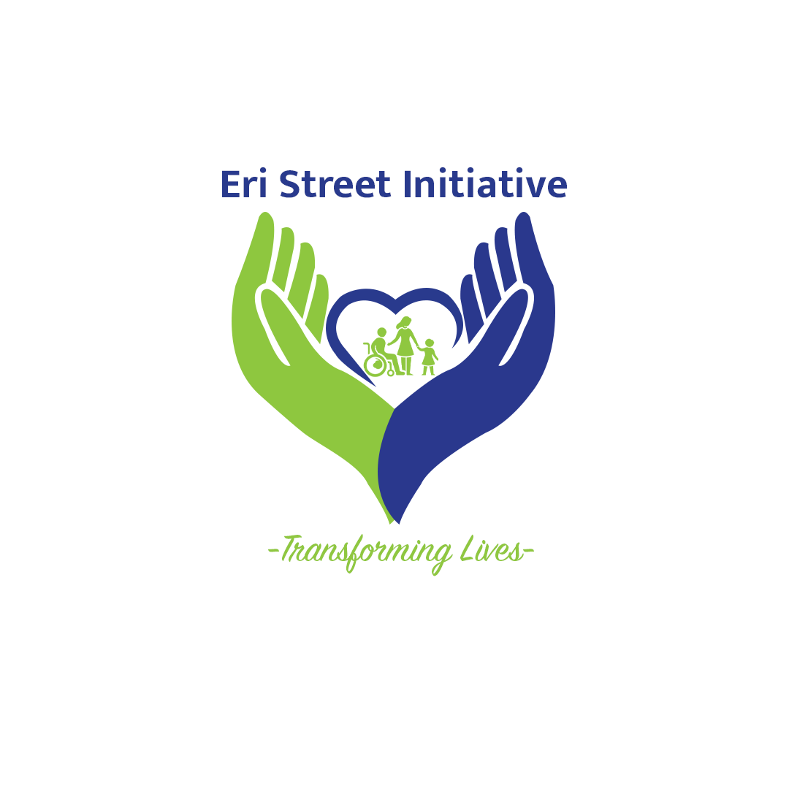
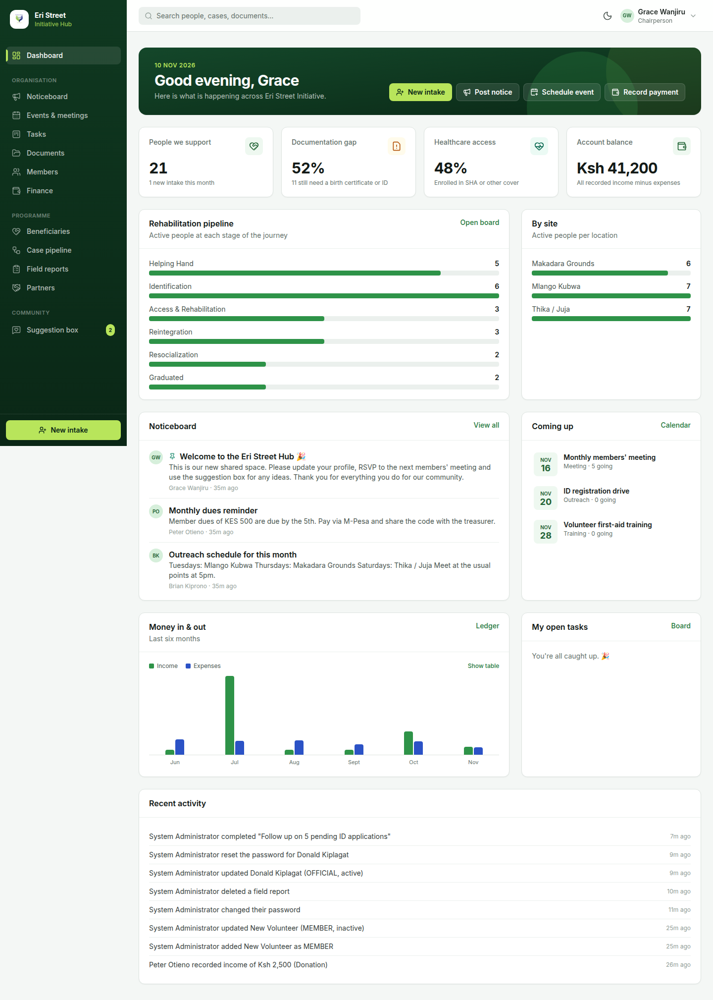
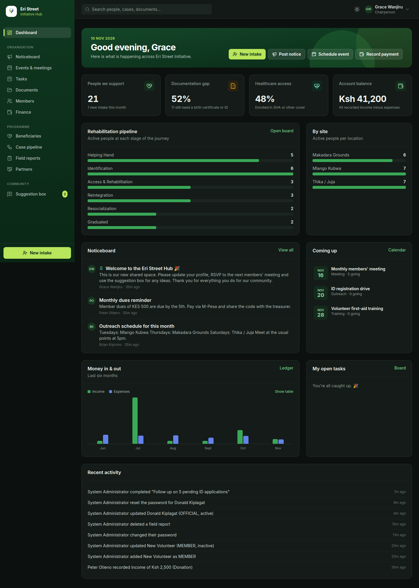
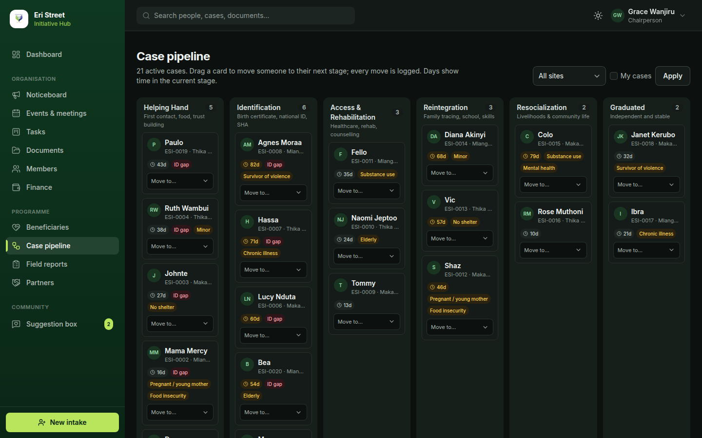
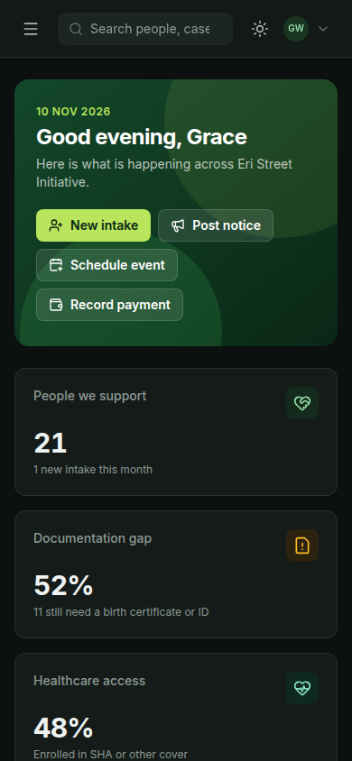

<p align="center"></p>

<h1 align="center">Eri Street Hub</h1>

<p align="center">
  The shared workspace for <strong>Eri Street Initiative</strong>, a Kenyan community organisation supporting
  street-connected people from first contact to independence.<br>
  Members, meetings, tasks, documents, money and every beneficiary's journey, all in one place.
</p>

<p align="center">
  
  
</p>

---

## What it does

### 🏛️ Running the organisation
| Module | What members can do |
|---|---|
| **Dashboard** | Live picture of the programme: people supported, documentation gap, healthcare access, money in & out, upcoming events, your tasks, recent activity. |
| **Noticeboard** | Post announcements to everyone, the field team, or leadership only. Pin important notices; discuss in comments. |
| **Events & meetings** | Schedule meetings, outreach days, trainings and fundraisers. RSVP, keep an attendance register (including walk-ins) and record **minutes**. |
| **Tasks** | Kanban board (drag & drop, with a keyboard/touch fallback), assignees, priorities, due dates, overdue flags. |
| **Documents** | One library for policies, SOPs, minutes, reports and templates: upload files or link to Drive, with audience controls. |
| **Members** | Directory with positions, sites, skills and contacts. Admins onboard people with one-time temporary passwords. |
| **Finance** | Transparent ledger of dues, donations, grants and expenses (KES, M-Pesa references), category breakdown, yearly CSV export. |
| **Suggestion box** | Anyone (including donors/viewers) can share ideas, **anonymously if they wish**; leadership responds publicly. |

### 🤝 The programme: beneficiary case management
The rehabilitation journey: **Helping Hand → Identification → Access & Rehabilitation → Reintegration → Resocialization → Graduated**.

| Module | |
|---|---|
| **Intake wizard** | 4-step registration (personal, ID documents, health & vulnerabilities, family & **consent**). Auto case numbers (`ESI-0001`). Works on a phone in the field. |
| **Beneficiary profiles** | Journey stepper, case-notes timeline, ID document tracking (birth certificate, national ID, SHA, social protection), interventions, stage history. |
| **Case pipeline** | Kanban across the six stages; shows days-in-stage, ID gaps and vulnerability flags. Every move is logged. |
| **Field reports** | Log interventions (food, health, documentation, counselling, referrals…), people reached and follow-ups needed. |
| **Partners** | Referral directory of hospitals, government offices, rehab centres, schools and NGOs. |

<p align="center"> </p>

### 🎨 Look & feel
- Green brand palette taken from the Eri Street logo, with a deep-forest sidebar and lime accents.
- **Light and dark mode**: toggle with the sun/moon button (top bar, login page, or *Settings → Appearance*).
  It follows your device setting until you choose, and remembers your choice.
- All colours are theme tokens (CSS variables in [`src/app/globals.css`](src/app/globals.css)); chart colours are
  checked for colour-blind safety and contrast in both themes.
- Responsive from phones (field use) to wide desktop screens.

### 🛡️ Built to protect the people it serves
- **Role-based access, enforced on the server** for every page, action, export and file. Hiding a button is never the only defence.
- Beneficiary data is visible **only to field staff, officials and admins**; members and viewers see aggregate numbers only.
- **Consent is required** before a beneficiary record can be saved (Kenya Data Protection Act, 2019).
- **Audit log** of every important change, including every export of personal data and every deleted transaction.
- Deactivating a member cuts off their access **immediately**, even mid-session.
- New accounts and password resets use **temporary passwords that must be changed on first sign-in**.
- Uploads are type- and size-checked; locally-stored files are served only to signed-in users, and beneficiary photos only to the field team.
- CSV exports are protected against spreadsheet formula injection. Security headers are on by default.

## Roles

| Role | Typical people | Access |
|---|---|---|
| **Administrator** | System admin | Everything, plus members, sites and the audit log |
| **Official** | Chair, treasurer, secretary | Everything except administration; manages finance |
| **Field staff** | Caseworkers, field officers | Beneficiaries, pipeline, field reports, events, tasks |
| **Member** | Volunteers, general members | Noticeboard, events, tasks, documents, members, partners |
| **Viewer** | Donors, observers | Dashboard (aggregates), noticeboard, events, documents, suggestions |

The full permission matrix is in [`src/lib/permissions.ts`](src/lib/permissions.ts) and visible in-app under **Administration → Roles & permissions**.

## Tech stack
Next.js 15 (App Router, Server Actions) · React 19 · TypeScript · PostgreSQL + Prisma 6 · NextAuth (credentials, JWT) · Tailwind CSS · Zod · Vitest · GitHub Actions.

## Getting started (local)

Requirements: **Node 20+** and **Docker** (for PostgreSQL).

```bash
git clone https://github.com/davidmunene/eri-street-hub.git
cd eri-street-hub
cp .env.example .env          # then fill in NEXTAUTH_SECRET and SEED_ADMIN_PASSWORD
npm install
npm run db:up                 # starts Postgres on localhost:5433
npm run db:migrate            # creates the tables
npm run db:seed               # creates the first admin (+ demo data if SEED_DEMO=true)
npm run dev                   # http://localhost:3000
```

Sign in with `SEED_ADMIN_EMAIL` / `SEED_ADMIN_PASSWORD`; you'll be asked to choose a new password.
With `SEED_DEMO=true` you also get fictional demo accounts (e.g. `chair@demo.eristreet.org`, `field1@demo.eristreet.org`,
`member1@demo.eristreet.org`, `donor@demo.eristreet.org`) using `SEED_DEMO_PASSWORD`, which is handy for seeing each role.

| Command | |
|---|---|
| `npm run dev` | Development server |
| `npm test` | Unit tests (permissions, validation, formatting) |
| `npm run lint` / `npm run typecheck` | Static checks |
| `npm run db:reset` | ⚠️ Wipe and re-seed the local database |

## Deploying (Vercel + managed Postgres)

1. Create a Postgres database (e.g. Neon, Supabase or Vercel Postgres) and copy its connection string.
2. Import this repository in Vercel. Set the environment variables from `.env.example`:
   `DATABASE_URL`, `NEXTAUTH_SECRET` (`openssl rand -base64 32`), `NEXTAUTH_URL` (your site URL).
3. Add a **Vercel Blob** store to the project. It sets `BLOB_READ_WRITE_TOKEN` automatically, which is required
   for uploads on Vercel because its filesystem is read-only.
4. Deploy. `vercel-build` runs `prisma migrate deploy` automatically.
5. Once, from your machine with the production `DATABASE_URL`: `SEED_DEMO=false npm run db:seed` to create the first admin.

> **Privacy note on Blob storage:** Vercel Blob URLs are public but unguessable. If you will store beneficiary photos in
> production, consider a private bucket (e.g. S3 with signed URLs) or leave photos out; [`src/lib/storage.ts`](src/lib/storage.ts)
> is the single place to change.

## Project structure
```
prisma/            schema.prisma (data model), migrations, seed.ts
src/lib/           auth, permissions, session guards, validation, audit, storage, formatting
src/components/    UI kit, app shell, forms, charts
src/app/(app)/     one folder per module: page.tsx (server) + actions.ts (server actions) + client forms
```

## Contributing
1. Create a branch, make your change, and run `npm run lint && npm test && npm run build`.
2. Any new page or server action must call `requireUser(permission)` / `authorize(permission)`.
3. Changes to the data model: `npx prisma migrate dev --name describe-change`, and commit the migration.

---
<p align="center">Made with ❤️ for Eri Street Initiative.</p>
